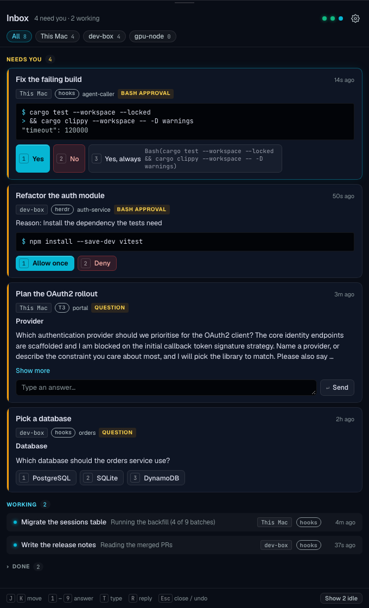
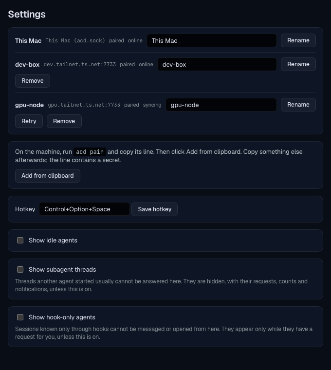

# agent-caller

[](https://github.com/tonibergholm/agent-caller/actions/workflows/ci.yml)
[](LICENSE)


An inbox for coding agents. When Claude Code asks for a permission, Codex
waits on a question, or an agent in herdr or T3 Code finishes, the request
shows up in one place, on whichever machine the agent runs. You answer it
there, with a 2-second undo, without hunting for the terminal.

agent-caller has three parts:

- **`acd`**, a Rust daemon that runs on every machine with agents. It
  collects requests from Claude Code and Codex hooks, from herdr, and from
  T3 Code, and serves them over a documented WebSocket protocol, `acd/1`.
- **Agent Caller**, a macOS menu bar app built with Tauri. It connects to
  the local daemon and to remote daemons over Tailscale, and takes spoken
  commands.
- **The Omarchy inbox**, a bar icon and panel for the Omarchy shell on
  Linux, served by a small user service, `acd-inbox`.

The Mac app is the reference client. Any other client (a CLI, a phone app)
can speak `acd/1` to the same daemon. The protocol is in
[`crates/acd-protocol/PROTOCOL.md`](crates/acd-protocol/PROTOCOL.md).

> **Status: pre-release (0.1.0).** There are no binary releases yet, and
> the Mac app is ad-hoc signed unless you supply a signing identity. You
> build both from source. Expect breaking
> changes to the config and protocol before 1.0.

## Screenshots

The current Svelte UI, rendered with sample agents through the development
preview. These screenshots contain fixture data, not live sessions.





## What it does

- Answers permission prompts and single-question, single-select
  questions, including typed answers for T3 questions that allow custom
  text. Multi-question and multi-select requests are shown read-only.
- Filters the inbox by machine and optionally shows idle agents, T3
  subagent threads and agents known only through hooks.
- Sends free-text follow-ups to idle or finished agents.
- Offers "Yes, always" for Claude `Bash` permissions, showing the exact
  rule it will save.
- Shows any other agent that herdr detects, with its state and a screen
  preview when it is blocked. These agents are read-only.
- Reaches remote machines over Tailscale, with a pinned TLS certificate
  per machine.
- On the Mac, takes spoken commands: hold a key and say "approve",
  "deny" or "yes always". See [Voice](#voice-macos).
- On Omarchy, shows the same inbox in the shell bar. See
  [Omarchy](#install-the-inbox-on-omarchy).

| Source | Agents | How acd answers |
|---|---|---|
| Claude Code hooks | Claude Code | Permissions: replies to the held `PermissionRequest` hook. Questions: one key through herdr. |
| Codex hooks | Codex | One key through herdr |
| herdr | Claude Code, Codex, others read-only | One option key, after checking the dialog on screen |
| T3 Code | T3 threads | T3 RPC commands |

Answering through herdr needs the agent to run in a herdr pane that acd
can identify. When it cannot, the request is shown read-only and you
answer in the terminal. Follow-ups go through herdr or T3, so an agent
that acd sees only through hooks cannot receive one.

## How it stays safe

The daemon sits between you and agents that can run commands, so a few
rules are fixed:

- **Fail open.** If acd is down, slow or undecided, the agent's own
  terminal dialog still works. acd never makes an agent hang.
- **Fail closed on delivery.** If acd cannot prove which agent and which
  dialog an answer belongs to, it does not deliver it. Before it sends a
  key through herdr, it re-reads the screen and compares a fingerprint of
  the dialog.
- **Bounded input paths.** Terminal delivery sends one option key for a
  matching dialog, or a follow-up that herdr accepts only when the agent
  is not blocked. Typed question answers go through T3 RPC only, when
  the request explicitly supports them.
- **First answer wins.** For hook and T3 answers, the agent accepts
  exactly one answer and the late one gets "Answered elsewhere". Key
  answers through herdr are best effort: a terminal answer can land
  between acd's screen check and its keystroke. acd never retries. It
  reports who answered when the screen shows it, and "uncertain"
  otherwise.
- **Narrow network exposure.** acd listens only on loopback and on its
  own Tailscale addresses. TCP connections use TLS 1.3 with a pinned
  certificate. Tokens are 32 random bytes in owner-only files and never
  reach the logs.

Known limit: Claude's HTTP hooks cannot authenticate the daemon, so
another local user who binds the hook port while acd is stopped could
answer a Claude permission. v1 targets a personal, trusted machine. See
spec §9, "Hook endpoint trust", for details.

## Requirements

- Rust 1.90 or newer.
- macOS or Linux for the daemon. Service install uses launchd on macOS and
  a systemd user unit on Linux.
- macOS 13 or newer and Node.js 24.15 or newer for the app. CI builds
  with Node 24. Voice needs macOS 26 (on-device speech recognition).
- Omarchy 4 on x86_64 Linux for the Omarchy inbox. Docker builds it from
  a Mac.
- [Tailscale](https://tailscale.com) for remote machines.
- Optional sources: [herdr](https://github.com/herdrdev/herdr)
  0.9.3 or newer (below 0.10), and T3 Code.

## Install the daemon

On each machine that runs agents:

```sh
git clone https://github.com/tonibergholm/agent-caller.git
cd agent-caller
cargo install --path crates/acd --locked

acd init                # config, tokens, TLS key in ~/.config/acd/
acd service install     # start at login (launchd or systemd --user)
acd status              # sources, agents and open requests
```

Use `acd run` instead of `acd service install` to run it in the
foreground. `acd service install --print` shows the service file without
writing it. The daemon reads its config at startup. After you edit it,
run `acd service install` again to restart the service.

### Connect the sources

**Claude Code and Codex.** Install the hooks once per machine:

```sh
acd hooks install claude
acd hooks install codex
acd hooks status
```

Start new agent sessions afterwards. Running Claude sessions keep the
hook config they started with. `acd hooks uninstall claude` and
`acd hooks uninstall codex` remove the entries acd manages and leaves your other hooks alone. Codex may ask
you to review the hooks the first time it runs them.

**herdr.** No setup. acd checks `$HERDR_SOCKET_PATH`, or
`~/.config/herdr/herdr.sock` when that is unset, plus the session
sockets under `~/.config/herdr/sessions/`, every 30 seconds. Add other
sockets with `herdr.extra_sockets` in the config.

**T3 Code.** Issue a token and set the server URL:

```sh
(umask 077; t3 auth session issue \
  --scope orchestration:read --scope orchestration:operate \
  > ~/.config/acd/t3.token)
```

Then set the T3 server address in `~/.config/acd/config.toml`:

```toml
[t3]
url = "http://127.0.0.1:3773"
```

Use the port your T3 server listens on. The URL is scheme, host and port only. The host must be `localhost`, a
loopback IP or a Tailscale IP, because the token travels over plain
`ws://`. MagicDNS names are refused here.

## Install the app (macOS)

From the repository root, with [`just`](https://github.com/casey/just) installed:

```sh
just app-install
```

This builds the app, replaces `/Applications/Agent Caller.app` and opens
it. It lives in the menu bar and adds the local machine on its own.
The build uses ad-hoc signing by default. Set `APPLE_SIGNING_IDENTITY` to
your stable signing identity before running the command to keep Keychain
and privacy grants across rebuilds. Ad-hoc rebuilds can prompt for
Keychain access again.

To build without installing, run `npm ci` and
`npm run tauri build -- --bundles app` from `app/`; the bundle is in
`app/src-tauri/target/release/bundle/macos/`.

To add a remote machine, run this on that machine and copy the line it
prints:

```sh
acd pair --host <machine>.<tailnet>.ts.net
```

Then click **Add from clipboard** in the app's settings. The line carries the client token and the certificate pin. The
app stores remote credentials in the Keychain; the local connection uses
`acd.sock` and reads the local token from the daemon config directory.
After `acd tls rotate`, pair remote machines again. On a remote Mac,
allow incoming connections for `acd` if the macOS firewall prompts.

### Using the app

The menu bar icon shows the most urgent state (amber: needs you, blue:
working, green: done) and how many agents need you. Press
**Control+Option+Space** for the panel. Focus stays in the app you were
using.

| Key | Action |
|---|---|
| `J` / `K`, arrow down / up | Move between cards |
| `1`–`9` | Pick an option and start the countdown |
| `T` | Focus the typed answer field for a T3 question |
| `R` | Reply to an idle or finished agent |
| `E` | Mark the agent seen |
| `Enter` | Send the reply or typed answer (in its text field) |
| `Esc` | Undo during the countdown, or close the panel |

The app waits 2 seconds before it sends an answer or reply. Press `Esc`
or click the countdown button to cancel. `Shift+Enter` adds a line in a
text field. Drag the panel header to move it and its edges to resize it;
the app remembers its position and size.

Settings lets you change the hotkey and show idle agents, subagent threads
and hook-only agents (all off by default). Hook-only agents still appear
when they have a pending request or are waiting on you. Hidden subagent
threads are excluded from counts, the tray badge and notifications.

Notifications appear for new requests while the panel is closed. If macOS
does not show them, enable Agent Caller in System Settings → Notifications;
the app does not yet request authorization or display its permission state.

### Voice (macOS)

Voice is off by default. Turn on **Voice control** in the app's settings;
the app then asks for Microphone, Speech Recognition and Input Monitoring
(the last one only for the hold key).

- Hold **Right Option** and speak, then release. Or press
  **Control+Option+V** to start and again to stop. Both can be changed in
  settings. Esc cancels a recording while the inbox or the voice HUD has
  focus; otherwise just release the key (a very short recording is
  ignored).
- Say "approve", "deny", "yes always", "option 2", "cancel", "next" or
  "previous". There is no intent model yet (a later step), so any other
  phrasing shows "Model unavailable".
- Speech is recognised on the Mac. Only English is supported. A recording
  stops at 60 seconds, and one under 0.3 seconds or without speech is
  ignored.
- A spoken answer goes through the same path as a typed one: the HUD shows
  what it understood, some answers (for example "yes always") are
  confirmed first, and the 2-second undo applies. Pressing the key again
  cancels a running countdown. Locking the screen or sleeping stops the
  microphone.

If the hold key does nothing, check System Settings → Privacy & Security
→ Input Monitoring. The toggle shortcut does not need it.

## Install the inbox on Omarchy

From a Mac with Docker, on the repository root:

```sh
just inbox-install you@omarchy
```

This builds `acd-inbox`, copies it to `~/.local/bin`, installs and starts
the user service, and installs the shell plugin. It never restarts the
shell: run `omarchy-restart-shell` once so the bar icon appears. To
install on the machine itself, run `acd-inbox install` there.
`acd-inbox status` shows the service, the socket, the keyring and the
plugin. `acd-inbox uninstall` removes the service, the plugin and the
binary; it leaves a keybinding you added and prints how to remove it.

The bar icon opens the panel, which shows the same cards and has the same
2-second undo as the Mac app. It reads the local `acd` and any remote machines you
pair in its settings. Remote tokens go to the Secret Service keyring.
New requests raise a desktop notification while the panel is closed.

To open it with a key, add this line to `~/.config/hypr/bindings.lua`
yourself (the installer prints it and only adds it when you say yes):

```lua
o.bind("SUPER + ALT + A", "Agent inbox", "omarchy-shell tonibergholm.agentcaller toggle")
```

## Configuration

`~/.config/acd/config.toml`. Set `ACD_CONFIG_DIR` to use another
directory.

| Key | Meaning | Default |
|---|---|---|
| `machine_name` | Name shown in the app | host name |
| `port` | `acd/1` WebSocket port | 47800 |
| `listen` | Addresses to bind: loopback and the machine's own Tailscale addresses only | `["loopback", "tailscale"]` |
| `hook_port` | Claude hook listener on `127.0.0.1`. Do not change it after installing hooks. | random in a config created by `acd init`, 47801 when the key is absent |
| `allowed_origins` | Browser origins allowed to connect | none |
| `claude.permission_hold` | Seconds to hold a Claude permission hook | 3600 |
| `ignored_entrypoints` | Claude entry points to ignore | `["sdk-ts"]` |
| `herdr.enabled`, `herdr.extra_sockets` | herdr source | enabled |
| `t3.enabled`, `t3.url` | T3 source. Needs `t3.url` and `t3.token`. | enabled, no URL |

Other commands:

- `acd token rotate client` replaces the client token. Pair the apps again.
- `acd token rotate hook` replaces the hook token. Running Claude
  sessions keep working with the old one until it is retired.
- `acd tls rotate` replaces the TLS certificate.

## Repository layout

| Path | Contents |
|---|---|
| `crates/acd-protocol` | `acd/1` wire types, JSON schema, pairing strings, `PROTOCOL.md` |
| `crates/acd-core` | Request engine, agent registry, server, TLS, idempotency |
| `crates/acd-adapters` | Sources: `hooks/` (Claude Code, Codex), `herdr/`, `t3/` |
| `crates/acd-client` | Client library used by the clients |
| `crates/acd-voice` | Voice command rules: routing, safety, recording, HUD states |
| `crates/acd-voice-client` | Voice controller that connects those rules to the inbox |
| `crates/acd-inbox` | The Omarchy `acd-inbox` service and installer |
| `crates/acd-securefs` | Owner-only file access |
| `crates/acd` | The `acd` binary: daemon, CLI, hook shim, service install |
| `app/` | Svelte frontend and Tauri backend (`app/src-tauri`), including the Swift speech bridge |
| `clients/omarchy/` | Omarchy shell plugin (Quickshell QML) |
| `tests/` | Recorded fixtures and the live end-to-end harness |
| `docs/` | Design spec, plans, research and live check records |

The design spec,
[`docs/superpowers/specs/2026-10-07-agent-inbox-design.md`](docs/superpowers/specs/2026-10-07-agent-inbox-design.md),
records the design and review decisions. For shipped behavior, check the
implementation and the [protocol guide](crates/acd-protocol/PROTOCOL.md);
historical plans are not instructions to reimplement completed phases.
Known gaps and deferred work are in
[`docs/superpowers/plans/2026-10-07-p1-followups.md`](docs/superpowers/plans/2026-10-07-p1-followups.md).

## Development

```sh
cargo test --workspace --locked
cargo clippy --workspace --all-targets --locked -- -D warnings

cd app && npm ci && npm run verify   # macOS only
```

CI runs the workspace on Ubuntu and macOS and the app on macOS.

To preview the UI with sample data, run `npm ci` and `npm run dev` in
`app/`, then open `/preview.html?scene=main` or
`/preview.html?scene=settings` on the URL Vite prints. This development
preview is excluded from the production build. See
[the screenshot guide](docs/images/README.md) for capture instructions.

`just e2e` runs real Claude Code, Codex and T3 agents against a scratch
daemon under `/tmp/ace2e`. It makes model calls, so run it only from an
interactive session. Read [`tests/e2e/README.md`](tests/e2e/README.md)
first.

Contributor rules are in [`CLAUDE.md`](CLAUDE.md). The short version:
every behavior change needs a test, a fix needs a test that fails without
it, and the workspace is not run through `cargo fmt` yet.

## Not in v1

Voice on Linux and Windows, spoken replies, a phone client and push
notifications, a self-hosted relay, starting new agents, transcript
browsing, multi-select answers, and a Windows desktop client. The protocol advertises
`capabilities` so these can arrive without breaking clients.

## License

[MIT](LICENSE)
